<div align="center">



# 🚀 Awesome Activity Feeds & Enterprise Microblogging

[](https://github.com/ishandutta2007/Awesome-Awesome-Awesome)
[](https://discord.gg/jc4xtF58Ve)
[](https://opensource.org/licenses/MIT)
[](https://github.com/ishandutta2007/Awesome-Activity-Feeds-Enterprise-Microblogging/pulls)
[](https://github.com/ishandutta2007/Awesome-Activity-Feeds-Enterprise-Microblogging)
[](https://github.com/ishandutta2007)

**A curated index of enterprise social intranets, internal activity streams, employee timeline engines, and self-hosted microblogging platforms.**

*Empower employee engagement, cross-functional knowledge sharing, and transparent internal communications with production-ready SaaS and open-source infrastructure.*

[🌟 Star on GitHub](https://github.com/ishandutta2007/Awesome-Activity-Feeds-Enterprise-Microblogging/stargazers) • [🍴 Fork Repository](https://github.com/ishandutta2007/Awesome-Activity-Feeds-Enterprise-Microblogging/network/members) • [💡 Propose an Addition](https://github.com/ishandutta2007/Awesome-Activity-Feeds-Enterprise-Microblogging/pulls) • [💖 Sponsor Developer](https://github.com/sponsors/ishandutta2007)

</div>

---

## 📑 Table of Contents

- [🔍 Sector Overview & Market Dynamics](#-sector-overview--market-dynamics)
- [💼 SaaS & Commercial Hosted Platforms](#-saas--commercial-hosted-platforms)
- [🔓 Open-Source GitHub Projects](#-open-source-github-projects)
  - [🏢 Enterprise Social Networks & Intranets](#-enterprise-social-networks--intranets)
  - [⚙️ Activity Stream Engines & Libraries](#️-activity-stream-engines--libraries)
  - [🌐 Decentralized & Federated Microblogging](#-decentralized--federated-microblogging)
- [🧭 Architecture & Selection Guide](#-architecture--selection-guide)
- [🤝 How to Contribute](#-how-to-contribute)
- [💖 Support & Sponsorship](#-support--sponsorship)
- [📊 Star History](#-star-history)
- [📜 Disclaimer](#-disclaimer)

---

## 🔍 Sector Overview & Market Dynamics

The global **Enterprise Social Software (ESS)** and **Social Intranet** sector is valued between **$22B and $27B**, forecasted to surge to **$50B–$99B** by the early 2030s while maintaining a robust **17%–18% CAGR**. 

Market competition exhibits a **moderately fragmented yet tiered** structure:
- **Ecosystem Titans** (Microsoft Viva Engage, Salesforce Chatter, Slack) command massive enterprise market share by bundling activity feeds directly into productivity and CRM software subscriptions.
- **Specialized Best-of-Breed Vendors** (Simpplr, Interact, Blink) dominate high-touch frontline employee communications and modern employee experience (EXP) portals, actively averting a single winner-take-all monopoly.
- **Self-Hosted Open-Source Frameworks** (HumHub, Stream-Framework, django-activity-stream, Misskey) empower privacy-conscious organizations, engineering orgs, and compliance-restricted defense/healthcare institutions to maintain complete corporate data sovereignty without per-seat licensing penalties.

---

## 💼 SaaS & Commercial Hosted Platforms

| Company / Product | 🏢 Organization Scale (Valuation / Revenue) | 💳 Starting Tier Pricing | 🎁 Free Tier / Trial Limits | 📌 Description & Key Capabilities |
| :--- | :--- | :--- | :--- | :--- |
| [**Microsoft Viva Engage**](https://www.microsoft.com/en-us/microsoft-viva/engage) | ~$3.1T Market Cap / ~$245B ARR (Microsoft) | Included in M365 Business Basic ($6.00/user/mo); Premium features via Viva Communications bundle at $2.00/user/mo | Included with M365 license; 30-day free trial (up to 25 seats) via M365 admin center for premium modules | 📣 Enterprise social network and storyline feeds deeply integrated with Microsoft 365, Teams, and Copilot AI. |
| [**Workplace from Meta**](https://www.meta.com/) | ~$1.5T Market Cap / ~$165B ARR (Meta) | ~$4.00/user/month (Historical base tier) | 30-day free trial (Historical; platform fully discontinued as of May 2026) | 👥 Social network experience modeled after Facebook for workplace collaboration and internal employee feeds. |
| [**Slack**](https://slack.com/) (Salesforce) | ~$330B Market Cap / ~$38B ARR (Salesforce) | $8.75/user/month (Pro plan billed monthly, $7.25 billed annually) | Free forever plan: 90 days of searchable message/file history, 1:1 huddles, up to 10 integrations | 💬 Channel-based collaboration platform with persistent message streams, activity canvases, and social huddles. |
| [**Salesforce Chatter**](https://www.salesforce.com/) | ~$330B Market Cap / ~$38B ARR (Salesforce) | Free with standard CRM license; $15.00/user/month (Standalone Chatter Plus) | Free forever plan: Up to 5,000 Chatter Free licenses per org (profiles, status feeds, groups, file sharing without CRM data access) | 📊 Enterprise social collaboration embedded natively inside Salesforce CRM objects, feeds, and workflows. |
| [**Zoho Connect / Feeds**](https://www.zoho.com/connect/) | ~$1.4B ARR / ~$10B–$15B Estimated Valuation (Zoho) | $1.00/user/month (Enterprise tier billed annually) or $3.00/user/month (Workplace Standard) | Free forever plan: Up to 5 users (basic feeds, channels, team collaboration, and 5 GB storage per user) | 🏢 Corporate social feeds, intranet walls, and team channels natively integrated within the Zoho productivity ecosystem. |
| [**Simpplr**](https://www.simpplr.com/) | ~$450M–$550M Valuation / $175M Total Funding | ~$4.00–$8.00/user/month (Mid-market contract baseline, quote-based) | 14-day free trial (curated sandbox environment, limited user spaces) | 🤖 AI-powered modern employee intranet and social communication engine designed to unify company updates and sentiment. |
| [**Interact**](https://www.interactsoftware.com/) | ~$100M–$150M PE Valuation / ~$25M–$35M ARR | ~$8.00/user/month (Mid-market starting tier, annual commitment) | 30-day free trial (enterprise sandbox environment for evaluation) | 📰 Enterprise social intranet software offering multi-channel news publishing, social feeds, and workforce analytics. |
| [**Blink**](https://www.joinblink.com/) | ~$100M Valuation / ~$15M–$25M ARR ($73M Funding) | $3.75/user/month (Core tier billed annually) or $4.50/month | 14-day free trial (full access to frontline employee feed, chat, and hub) | 📱 Mobile-first employee app and activity feed purpose-built for deskless and frontline workforces. |
| [**Chanty**](https://www.chanty.com/) | ~$30M ARR (Bootstrapped) | $3.00/user/month (Business tier billed annually) or $4.00/month | Free forever plan: Up to 5 users, unlimited message history, 20 GB team storage, 1:1 video calls, up to 10 integrations | 📋 Team collaboration platform combining channel communication, social feed updates, and built-in Kanban task management. |
| [**Jostle**](https://jostle.me/) | ~$12.5M ARR / ~$6M Funding | $2.50/user/month (Base employee tier, billed annually) | 30-day free trial (full platform access for team evaluation) | ❤️ People-centric employee intranet emphasizing visual news feeds, employee recognition, discussions, and org directories. |

---

## 🔓 Open-Source GitHub Projects

All open-source repositories below are sorted in **descending order by GitHub stargazers**. Each badge directly links to the repository's live stargazers page.

### 🏢 Enterprise Social Networks & Intranets

- [**Mastodon**](https://github.com/mastodon/mastodon) [](https://github.com/mastodon/mastodon/stargazers)
  - **Description**: Self-hosted, globally interconnected microblogging community and server platform built on Ruby on Rails and the ActivityPub standard. Frequently deployed by privacy-conscious enterprises and institutions as an isolated, internal microblogging network.
  - **Stack**: Ruby on Rails, Node.js, PostgreSQL, Redis • **License**: AGPL-3.0
  - **Best For**: Organizations establishing sovereign internal microblogging servers or private network instances.

- [**HumHub**](https://github.com/humhub/humhub) [](https://github.com/humhub/humhub/stargazers)
  - **Description**: The leading self-hosted open-source enterprise social network and intranet solution. Features modular spaces, activity feeds, full profile directories, notification hubs, poll systems, and rich markdown/rich-text document editors.
  - **Stack**: PHP (Yii2 Framework), MySQL/MariaDB, Redis, Docker • **License**: AGPL-3.0 (Community Edition)
  - **Best For**: SMBs and enterprise teams requiring an on-premise social intranet with an extensive 80+ module marketplace.

- [**Bootcamp**](https://github.com/vitorfs/bootcamp) [](https://github.com/vitorfs/bootcamp/stargazers)
  - **Description**: Dedicated open-source enterprise social network written in Python and Django. Features user timelines, activity feeds, questions & answers, article sharing, and direct messaging channels.
  - **Stack**: Python 3, Django, PostgreSQL, JavaScript • **License**: MIT
  - **Best For**: Engineering teams wanting a lightweight, easily modifiable Django-based enterprise social template.

- [**Elgg**](https://github.com/Elgg/Elgg) [](https://github.com/Elgg/Elgg/stargazers)
  - **Description**: Award-winning social networking engine offering a robust foundation for building internal enterprise social intranets, university networks, and campus collaboration hubs.
  - **Stack**: PHP, MySQL, Apache/Nginx • **License**: GPL-2.0 / MIT
  - **Best For**: Educational organizations and enterprises seeking a proven, customizable social framework.

- [**Open Source Social Network (OSSN)**](https://github.com/opensource-socialnetwork/opensource-socialnetwork) [](https://github.com/opensource-socialnetwork/opensource-socialnetwork/stargazers)
  - **Description**: Modular social networking software developed in PHP that enables organizations to deploy an internal social network mimicking Facebook's wall, feed, and friend relationships.
  - **Stack**: PHP, MySQL, JavaScript • **License**: Open Source Social Network Public License (OSSN PL)
  - **Best For**: Rapid deployment of internal company social walls and employee relationship boards.

- [**eXo Platform**](https://github.com/exoplatform/platform-public-distributions) [](https://github.com/exoplatform/platform-public-distributions/stargazers)
  - **Description**: Mature open-source digital workplace and social intranet platform with enterprise activity streams, document management, team spaces, wikis, and video conferencing.
  - **Stack**: Java, Spring Boot, Tomcat, PostgreSQL/MySQL • **License**: LGPL-3.0
  - **Best For**: Large enterprises with in-house Java operations requiring strict regulatory data compliance.

- [**Tahitter**](https://github.com/Ryasnov-Tahir/Tahitter) [](https://github.com/Ryasnov-Tahir/Tahitter/stargazers)
  - **Description**: Minimalist microblogging architecture implementation built with modern FastAPI and PostgreSQL. Features tweet creation, follower graphs, and algorithmic feed sorting.
  - **Stack**: Python 3.11, FastAPI, SQLAlchemy, PostgreSQL, Docker Compose • **License**: Open Source
  - **Best For**: Developers seeking a clean microservice reference architecture for internal microblogging.

---

### ⚙️ Activity Stream Engines & Libraries

- [**Stream Framework**](https://github.com/tschellenbach/Stream-Framework) [](https://github.com/tschellenbach/Stream-Framework/stargazers)
  - **Description**: Python library and engine that allows developers to build high-scale news feeds, activity streams, and notification systems utilizing Cassandra and Redis (the open-source foundation created by the founders of Stream.io).
  - **Stack**: Python, Redis, Apache Cassandra • **License**: BSD-3-Clause
  - **Best For**: High-throughput distributed applications generating millions of fan-out-on-write or fan-out-on-read activity stream events.

- [**django-activity-stream**](https://github.com/justquick/django-activity-stream) [](https://github.com/justquick/django-activity-stream/stargazers)
  - **Description**: Full-featured implementation of the W3C Activity Streams specification for Django apps. Generates generic activity streams from actions on your service (`actor`, `verb`, `action_object`, `target`).
  - **Stack**: Python, Django, PostgreSQL/MySQL • **License**: BSD-3-Clause
  - **Best For**: Adding activity feeds, audit logs, and employee timeline streams to existing Django applications.

---

### 🌐 Decentralized & Federated Microblogging

- [**Lemmy**](https://github.com/LemmyNet/lemmy) [](https://github.com/LemmyNet/lemmy/stargazers)
  - **Description**: Link aggregator and discussion platform for the fediverse, written in Rust. Perfectly suited for internal link sharing, upvoting, and departmental discourse feeds.
  - **Stack**: Rust, Actix-web, Diesel, PostgreSQL • **License**: AGPL-3.0
  - **Best For**: Internal social bookmarking, team discussion boards, and Reddit-style company forums.

- [**Misskey**](https://github.com/misskey-dev/misskey) [](https://github.com/misskey-dev/misskey/stargazers)
  - **Description**: Feature-rich, highly customizable decentralized microblogging platform with real-time timeline updates, rich media drives, emoji reactions, and built-in dashboards.
  - **Stack**: TypeScript, Node.js, PostgreSQL, Redis, Vue.js • **License**: AGPL-3.0
  - **Best For**: Creative teams and tech companies wanting an interactive, emoji-rich internal microblogging hub.

- [**AT Protocol (Bluesky)**](https://github.com/bluesky-social/atproto) [](https://github.com/bluesky-social/atproto/stargazers)
  - **Description**: The Authenticated Transfer Protocol—a decentralized protocol for large-scale social networking and algorithmic timeline curation.
  - **Stack**: TypeScript, Go, Lexicon Schema • **License**: Apache-2.0 / MIT
  - **Best For**: Advanced engineering teams building custom algorithmic feed generators and decentralized timeline protocols.

- [**BitOS Enterprise Social Network**](https://github.com/bitoslabs/BitOS) [](https://github.com/bitoslabs/BitOS/stargazers)
  - **Description**: Decentralized enterprise collaboration suite built on Nostr relays. Combines cryptographically signed enterprise feeds, direct messaging, and workflow tools.
  - **Stack**: Nuxt 3, Nostr Relays, IPFS, PostgreSQL • **License**: MIT
  - **Best For**: Experimental decentralized organizations seeking censorship-resistant, keypair-authenticated activity feeds.

---

## 🧭 Architecture & Selection Guide

```
                                  ┌──────────────────────────┐
                                  │ What are your primary    │
                                  │ collaboration requirements│
                                  └────────────┬─────────────┘
                                               │
               ┌───────────────────────────────┼──────────────────────────────┐
               ▼                               ▼                              ▼
      [Real-time Chat]               [Social Intranet / Hub]          [Activity Stream Backend]
       ├── Slack (Commercial)         ├── Microsoft Viva Engage        ├── Stream-Framework (Cassandra/Redis)
       └── Chanty (SaaS)              ├── HumHub (Open Source)         └── django-activity-stream (Django)
                                      ├── eXo Platform (Java)
                                      └── Simpplr / Blink (Mobile Frontline)
```

1. **Microsoft Ecosystem Heavy?** 👉 **Microsoft Viva Engage** provides the most frictionless entry point with zero license add-on fees for basic communities on existing M365 plans.
2. **Strict Data Sovereignty or Air-Gapped Intranet?** 👉 Deploy **HumHub** via Docker for immediate out-of-the-box social feeds, or **Bootcamp** for Django web teams.
3. **Building a Custom In-House Activity Feed?** 👉 Integrate **Stream Framework** or **django-activity-stream** directly into your data pipeline.
4. **Frontline or Deskless Workforce?** 👉 **Blink** offers mobile-first operational communication feeds.

---

## 🤝 How to Contribute

Contributions are welcome! Help us expand and maintain this index:

1. 🍴 **Fork** this repository.
2. 🌿 Create a branch for your addition (`git checkout -b feature/add-platform-name`).
3. 📝 Update `README.md` following the established tabular or list format (include starting pricing, free limits, and open-source star badges).
4. 🚀 Push your branch and open a **Pull Request**.

Please refer to the curated lists repository at [Awesome-Awesome-Awesome](https://github.com/ishandutta2007/Awesome-Awesome-Awesome) for more great developer resources!

---

## 💖 Support & Sponsorship

Thank you so much for exploring and using this repository! If this project helped you discover solutions or architect your internal communications stack, please consider supporting the project:

- 🌟 **Star this repository** to improve visibility!
- 🍴 **Fork and share** with colleagues and dev communities!
- ☕ **Buy a coffee & sponsor**: Support continuous maintenance via the [GitHub Sponsor Dashboard](https://github.com/sponsors/ishandutta2007).

---

## 📊 Star History

[](https://www.star-history.com/#ishandutta2007/Awesome-Activity-Feeds-Enterprise-Microblogging&type=date&legend=top-left)

---

## 📜 Disclaimer

- This repository is community-curated for informational and architectural guidance; inclusion does not constitute commercial endorsement.
- All trademarks, service marks, and logos belong to their respective corporate entities.
- Activity feed systems handling company data must follow corporate governance and regulatory compliance frameworks (GDPR, CCPA, HIPAA, SOC 2).
